

  

  <a href="mailto:sguan.harry@outlook.com">Email</a>&nbsp;&nbsp;/&nbsp;&nbsp;<a href="[https://www.linkedin.com/in/sheng-harry-guan-a9a991280](https://www.linkedin.com/in/sheng-guan-a9a991280)">LinkedIn</a>&nbsp;&nbsp;/&nbsp;&nbsp;<a href="https://orcid.org/0009-0002-9597-8329">ORCID</a>

I'm an MPhil student in Computer Science and Engineering at CUHK. My work sits between research and engineering: I turn new methods into tested, reusable code, and I check the data before I trust a result. Lately that means LLM agents and their evaluation, agent memory, model serving, and watermarking for generative models.

Currently taking an intentional **GAP**, I'm open to internships and full-time roles in LLM and agent application engineering and applied AI, in Hong Kong and mainland China.

## Agent engineering

<a href="https://github.com/codelformat/Aftersales-agent"></a>

  
  
  
  

A customer-service agent for an online shop, built on LangGraph, Milvus and MCP. It routes each question, cites its evidence, and refuses when the evidence is weak; a calibrated gate makes that call, and human review turns refusals into new knowledge. I set the goals and made the design decisions. AI coding agents wrote the code under my specs, tests and review.

In 30 seconds: [watch a recorded session](https://codelformat.github.io/Aftersales-agent/) / [read the decision records](https://github.com/codelformat/Aftersales-agent#decision-records) / [see what broke and how I fixed it](https://github.com/codelformat/Aftersales-agent#what-broke-and-how-i-fixed-it).

## Research software

<a href="https://github.com/THU-BPM/MarkDiffusion">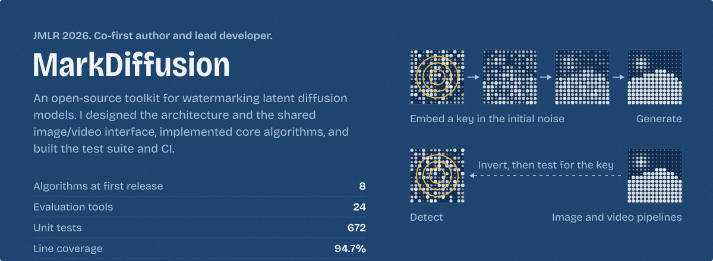</a>

  
  
  
  

`pip install markdiffusion` works today, and I maintain the conda-forge feedstock.

  <a href="https://github.com/THU-BPM/Watermarked_LLM_Identification">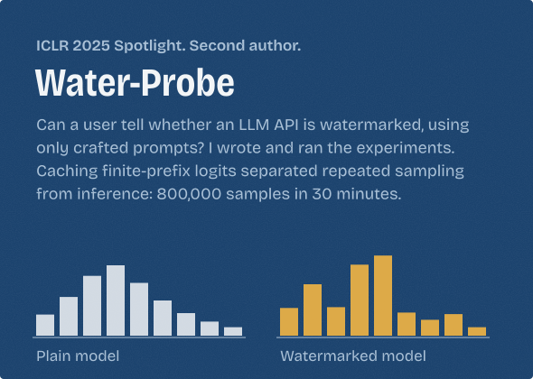</a>
  <a href="https://github.com/THU-BPM/MarkLLM">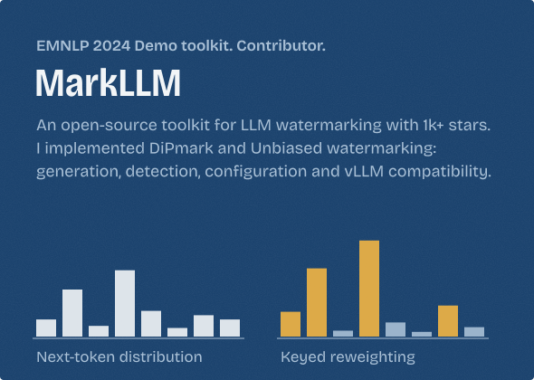</a>

## Publications

- **MarkDiffusion: An Open-Source Toolkit for Generative Watermarking of Latent Diffusion Models.** JMLR, 2026. Co-first author.
  [Paper](https://www.jmlr.org/papers/v27/25-2553.html) / [arXiv](https://arxiv.org/abs/2509.10569) / [Code](https://github.com/THU-BPM/MarkDiffusion)
- **Can Watermarked LLMs be Identified by Users via Crafted Prompts?** ICLR 2025, Spotlight. Second author.
  [arXiv](https://arxiv.org/abs/2410.03168) / [Code](https://github.com/THU-BPM/Watermarked_LLM_Identification)
- **Refining Positive and Toxic Samples for Dual Safety Self-Alignment of LLMs with Minimal Human Interventions** (PT-ALIGN). IEEE TIFS, 2026. Third author.
  [Paper](https://doi.org/10.1109/TIFS.2026.3652843) / [arXiv](https://arxiv.org/abs/2502.08657)
- **RecMem: Recurrence-based Memory Consolidation for Efficient and Effective Long-Running LLM Agents.** Findings of ACL, 2026. Third author.
  [arXiv](https://arxiv.org/abs/2605.16045) / [Code](https://github.com/CaiusDai/RecMem)
- **Omni-SafetyBench: A Benchmark for Safety Evaluation of Audio-Visual Large Language Models.** ACM Multimedia 2026, Oral. Co-author.
  [arXiv](https://arxiv.org/abs/2508.07173)

## Recent engineering

**MemTensor, algorithm engineering intern** (Dec 2025 to Apr 2026). Offline research on storing user preferences in model weights instead of retrieving history.

- Built a three-stage topic, question and answer synthesis pipeline that averaged 160,000+ QA pairs per user, with ROUGE-L filtering, LLM quality checks, concurrent API calls, JSON validation, retries and checkpoint recovery.
- Trained per-user Qwen3-0.6B LoRA adapters and combined them with Qwen3-8B through contrastive decoding. PersonaMem accuracy rose 28 points over unadapted Qwen3-8B, with no user history at inference and a strict train/test split.
- Measured where it broke (unstable gains at larger sizes, loss of general capability), which led the team not to pursue the approach.
- Wrote Chapter 2 of 《记忆工程·智能体记忆系统构建与实践》 and maintain bilingual resources in [Awesome-AI-Memory](https://github.com/IAAR-Shanghai/Awesome-AI-Memory).

**LiveServe.** Adapted Ming-Flash-Omni to vLLM-Omni as a Thinker, Talker and Code2Wav pipeline, and set the team's TTFP and audio RTF latency baselines.

**RecMem.** Ran the MemoryOS baseline on LoCoMo and LongMemEval-S: dataset adapters, LLM-as-a-Judge scoring, and token accounting across memory construction and answering.

## Path so far

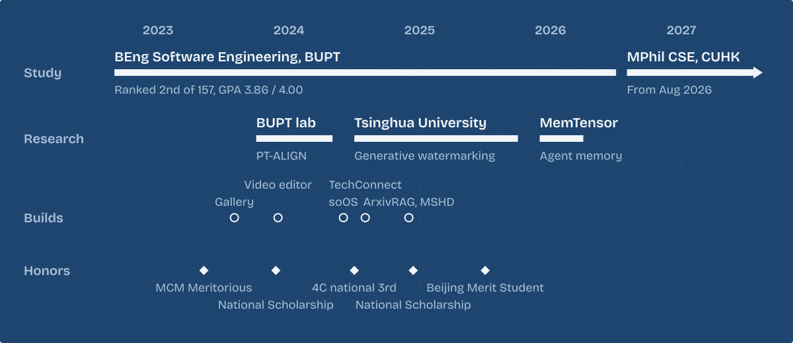

## Built during undergrad

Course, competition and social-practice projects from BUPT, 2023 to 2024. Each one took me one layer further down or across the stack.

  <a href="https://github.com/codelformat/BUPTLab-bigdata-project">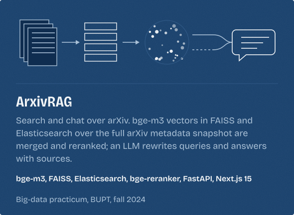</a>
  <a href="https://github.com/codelformat/soOS">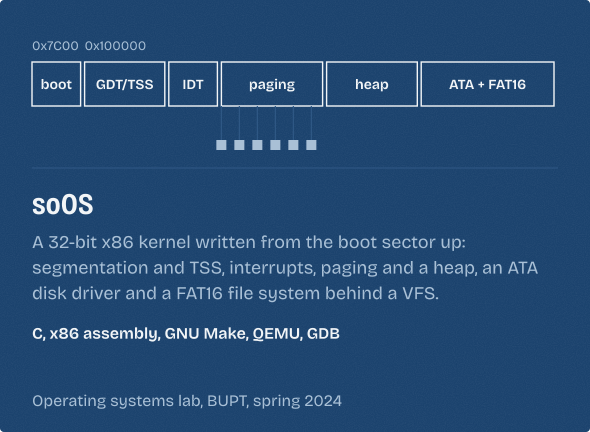</a>

  <a href="https://github.com/codelformat/CPP_2023_VideoEditor">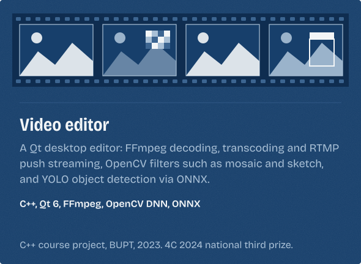</a>
  <a href="https://github.com/codelformat/GuizhouGallery_2023_summer">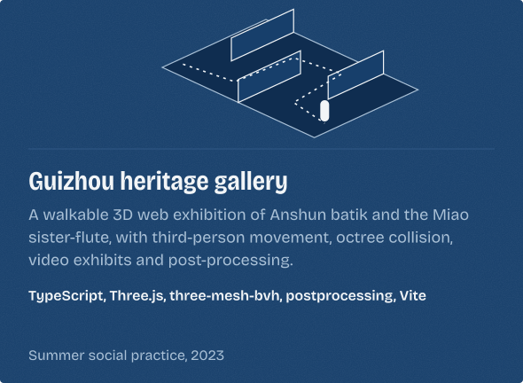</a>

  <a href="https://github.com/codelformat/buptLab-MSHD">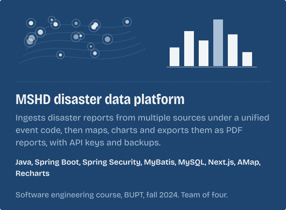</a>
  <a href="https://github.com/codelformat/buptLab-TechConnect-Blog">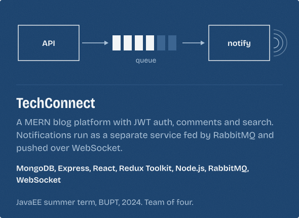</a>

Also: a [course-management system](https://github.com/codelformat/BUPTLab-OOAD) for the object-oriented design course (Spring Boot, JPA, H2).

## Toolbox

- **Agents and LLM apps:** LangGraph, LangChain, MCP, Milvus (dense and BM25), rerankers, Langfuse, FastAPI, Playwright
- **Models and training:** Python, PyTorch, Transformers, Diffusers, vLLM and vLLM-Omni, DeepSpeed, LoRA
- **Evaluation and quality:** pytest, GitHub Actions, LLM-as-a-Judge, LoCoMo, LongMemEval
- **Data and retrieval:** Elasticsearch, FAISS, ChromaDB, bge-m3 and rerankers, Ray, FastAPI
- **Systems and media:** C, x86 assembly, C++, Qt, FFmpeg, OpenCV
- **Web:** TypeScript, React, Next.js, Three.js, Node.js, Spring Boot, MySQL, MongoDB, RabbitMQ

<b>中文简介</b>

 

我是管昇（Harry），香港中文大学计算机科学与工程 MPhil 在读，本科毕业于北京邮电大学软件工程（GPA 3.86/4.00，专业排名 2/157，两次国家奖学金）。我的工作介于研究和工程之间：把新方法做成经过测试、可复用的代码，并且在相信一个结果之前先检查数据。

研究经历包括清华大学（生成式水印：MarkDiffusion、Water-Probe、MarkLLM）、北邮移动网络技术研究中心（大模型安全对齐 PT-ALIGN），以及记忆张量 MemTensor（个性化记忆）。目前关注大模型智能体与评测、智能体记忆、模型推理服务和可信生成式 AI。近期作品：[电商售后智能客服 Aftersales Agent](https://github.com/codelformat/Aftersales-agent)（LangGraph、混合检索与重排、校准的置信度闸、MCP 工具），可以[在线观看真实会话回放](https://codelformat.github.io/Aftersales-agent/)。欢迎联系：sguan.harry@outlook.com

The banner is watermarked.

 

The small grid in its lower-right corner holds 40 bits. Read it column by column, top to bottom, with amber as 1. Five columns, eight bits each, ASCII.

Answer

`01001000 01000001 01010010 01010010 01011001` spells **HARRY**.

So is the Aftersales Agent card.

 

The dots in its lower-right corner hold 56 bits. Read them the same way: column by column, top to bottom, amber as 1. Seven columns, eight bits each, ASCII.

Answer

They spell **547069d**, the commit that [added the evaluation report](https://github.com/codelformat/Aftersales-agent/commit/547069d) behind the card's numbers.

